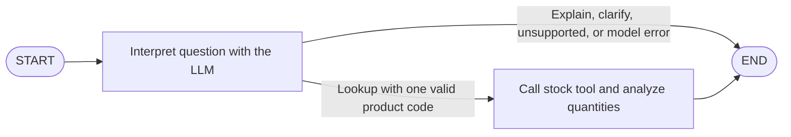

# SCTEC Inventory Assistant

This project is part of the **SCTEC AI Agents course**. It uses **Gemini 3.8 Flash** to interpret stock questions in English and instructor **Wanderson Souza's** [stock API](https://github.com/wangsouza/api-estoque) as its data source. His [course repository](https://github.com/wangsouza/agents-senai) is the reference for LangGraph, HTTP tools, and n8n.

[View the recorded executions](evidence/executions.json)

## How the agent works



The shared state carries the question, the validated code when present, and the result. The first node requests a structured answer from Gemini through the Google Gemini API and validates the intent with Pydantic. Python checks that a lookup has one unambiguous code. The conditional edge either calls the stock node or finishes with a direct answer.

The stock node calls `lookup_product(code)` in [stock.py](inventory_agent/stock.py). That tool uses `GET /produtos/{codigo}`, checks the HTTP status, and validates the response with Pydantic. The LLM receives only the question. Python builds product answers from the validated quantities and unit returned by the official API.

| Condition | Stock level |
| --- | --- |
| Quantity equals zero | Out of stock |
| Positive quantity at or below the minimum | Low |
| Quantity above the minimum | Available |

The response includes `route`, `tool_called`, and the upstream HTTP status when available. These fields show which path actually ran. Both paths end after at most two nodes, and both HTTP clients use timeouts.

## Run locally

You need Python 3.11 or newer, Git, internet access, and a Google AI Studio API key with access to `gemini-3.8-flash`. The commands below use PowerShell.

### 1. Start the official stock API

Run these commands from the project folder in a separate terminal. The API has its own repository and virtual environment.

```powershell
git clone https://github.com/wangsouza/api-estoque.git api-estoque
Set-Location api-estoque
python -m venv .venv
. .\.venv\Scripts\Activate.ps1
python -m pip install -r requirements.txt
python -m uvicorn app.main:app --host 127.0.0.1 --port 8000
```

The official API's Swagger is at [localhost:8000/docs](http://127.0.0.1:8000/docs).
If port 8000 is in use, start the stock API on another port and set `STOCK_API_URL` in the agent's `.env`. The recorded run used port 8002 for the stock API.

### 2. Configure Gemini 3.8 Flash

Create a key in [Google AI Studio](https://aistudio.google.com/apikey) with access to [Gemini 3.8 Flash](https://aistudio.google.com/docs/models/gemini-3.8-flash). From the project folder, create `.env` if needed and set `GEMINI_API_KEY` in that file. Keep the key in your local `.env` or environment variables.

```powershell
if (-not (Test-Path .env)) { Copy-Item .env.example .env }
notepad .env
```

### 3. Start the agent

Run from this repository in a separate terminal.

```powershell
python -m venv .venv
. .\.venv\Scripts\Activate.ps1
python -m pip install -r requirements.txt
python -m uvicorn inventory_agent.main:app --env-file .env --host 127.0.0.1 --port 8001
```

Send a question through the [agent's Swagger UI](http://127.0.0.1:8001/docs) or PowerShell.

```powershell
Invoke-RestMethod -Method Post -Uri http://127.0.0.1:8001/analyze `
  -ContentType application/json `
  -Body '{"question":"Is PRD-001 low on stock?"}' | ConvertTo-Json -Depth 5
```

## Run the n8n workflow

1. Open a local [n8n installation](https://docs.n8n.io/deploy/host-n8n/install-options/install-using-docker-compose/) and import [Inventory Analysis](n8n/inventory-analysis.json).
2. Check the URL in **Call Python Agent**. The default works when n8n runs on the same host. With n8n in Docker, use an address the container can reach, such as `http://host.docker.internal:8001/analyze` on Docker Desktop, and bind the agent to a reachable development interface.
3. Open **Receive Question**, click **Listen for test event**, and copy its Test URL. Send the same JSON used above to `http://127.0.0.1:5678/webhook-test/inventory-analysis`.
4. Inspect the request and response in n8n. If you publish the workflow, use its Production URL at `/webhook/inventory-analysis`.

The webhook passes the question to the Python endpoint and returns the last node's JSON. LangGraph owns the intent decision, API call, and answer.

The workflow was imported, executed, and exported with n8n 2.35.7 in Docker. The [original verification run](https://github.com/renan-leme/ai-agents-SCTEC/actions/runs/45298329349) predates the Gemini migration and shows the webhook response and saved workflow execution.

## Reproduce the evaluation tests

Repeat the agent request above with each question to test with Gemini. The [test evidence](evidence/executions.json) identifies which services were used in the recorded checks. The Gemini adapter also has a regression suite that uses simulated responses and requires no API key.

```powershell
python -m unittest discover -s tests -v
```

| Scenario | Question | Expected result |
| --- | --- | --- |
| Existing product | Is PRD-001 low on stock? | Lookup, HTTP 200 from the stock API, quantity 5, minimum 10, low. |
| Missing product | Check the stock of PRD-999. | Lookup, HTTP 404 from the stock API, clear missing-product message. |
| Concept question | What does minimum stock mean? | Explanation and `tool_called: false`. |
| Upstream failure | Check the stock of PRD-503. | Lookup, HTTP 503 from the stock API, temporary-unavailability message. |

## Limitations

This is a single-question, single-product prototype. A product lookup needs a `PRD-XXX` code, and each request starts a fresh graph run. The tool has read-only access. The official stock API and the agent run locally, and the agent sends the question to Google's API for interpretation. Model calls depend on Gemini API access and quota, and stock lookup depends on the official API being available.
